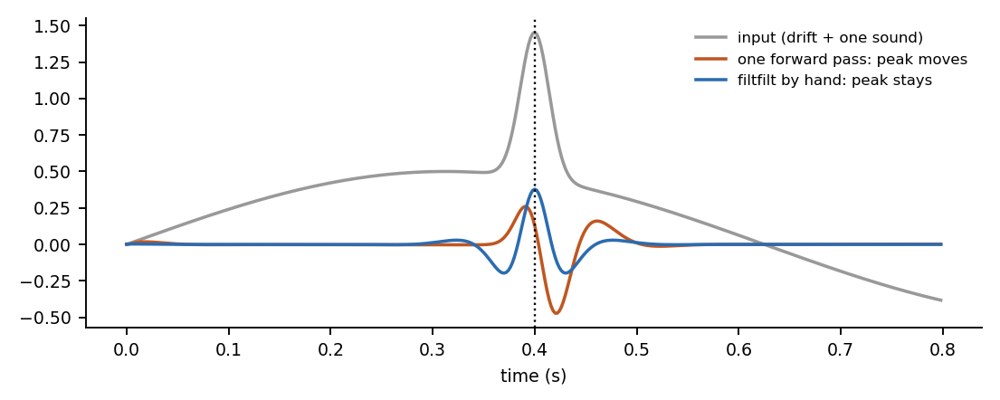

# Module 1: zero-phase filtering (`filtfilt`) by hand

**Question:** a heart sound sits on slow drift (breathing, movement). A filter removes the drift, but a filter also shifts the signal in time. How do you remove the drift without moving S1 and S2?

**Answer in one line:** filter forward, flip the result, filter again, flip back. The shift from the first pass is undone by the second.



## The four steps

A second-order filter is one rule applied sample by sample (Direct Form II transposed):

```
y[n]  = b0 x[n] + z1
z1    = b1 x[n] - a1 y[n] + z2
z2    = b2 x[n] - a2 y[n]
```

1. **Forward:** run the rule from the first sample to the last.
2. **Flip** the output in time.
3. **Filter it again** with the same rule. Now it runs backward in time.
4. **Flip back.**

The forward pass changes the phase by some amount; the backward pass changes it by the opposite amount. The net phase shift is zero, so peaks stay where they were. The size (magnitude) response is applied twice, so it is the **square** of the single-pass response. One pass of a Butterworth is 3 dB down at the cut-off frequency; filtfilt is 6 dB down there, so the effective cut-off moves slightly inward.

## The two details that make it work at the edges

* **Start-up state.** A filter started from zero sees the first sample as a jump and rings. We start each pass in the state the filter would have if the input had always been equal to the first sample. For a second-order filter, with DC gain `G = (b0+b1+b2)/(1+a1+a2)`:
  `zi1 = b1 + b2 - (a1+a2) G`,  `zi2 = b2 - a2 G`, and we start with `zi x first_sample`.
* **Odd padding.** Before filtering, 9 samples (3 x filter length) are added at each end by mirroring around the end point: `2 x[0] - x[k]`. It continues the slope instead of making a corner. They are removed after the second pass.

## Files

| File | What it is |
|---|---|
| [`filtfilt_by_hand.xlsx`](filtfilt_by_hand.xlsx) | 40 samples, padded to 58, forward pass, flip, backward pass, flip, compared with scipy |
| [`../hsbh/filt.py`](../hsbh/filt.py) | the same steps as loops: `lfilter_df2t`, `zi_second_order`, `lfilter_zi`, `odd_extension`, `filtfilt_by_hand` |
| [`../tests/test_filt.py`](../tests/test_filt.py) | compares with `scipy.signal.lfilter` and `filtfilt` on random signals, high-pass, band-pass and low-pass |
| [`exercises.md`](exercises.md) | questions with checks |

## Why it matters for heart sound, and the limit

Zero phase keeps S1 and S2 at their true times, which matters when you later measure intervals (systole length) or compare envelopes. The limit: **filtfilt needs the whole signal**, because the second pass runs backward. It cannot run in real time on a device that receives samples one by one. A real-time system uses one forward pass and accepts the time shift, or filters short blocks with padding. Decide which before you design a stethoscope algorithm.
