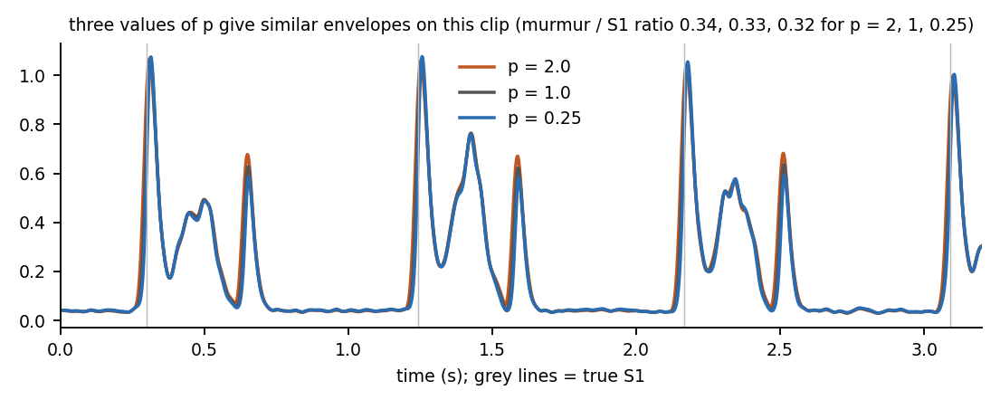

# Module 2: the envelope by hand

**Question:** a heart sound is a fast wiggle (30 to 200 Hz). To find where S1 and S2 are, we need a smooth curve that is high when the sound is loud and low when it is quiet: the envelope.

## Three steps

1. **Amplitude from the Hilbert transform.** Pair the signal `x` with its 90-degree-shifted copy `H(x)`; the amplitude is `sqrt(x^2 + H(x)^2)`. A truncated filter does the shift:
   `H(x)[n] = sum over odd j of 2/(pi j) * (x[n-j] - x[n+j])`, for j = 1, 3, ..., 15.
2. **Power mean.** Raise the amplitude to a power `p`, smooth, take the `p`-th root. `p = 1` is a plain average. A smaller `p` compresses big values before averaging, so one loud peak counts for less in each local average; `p = 2` lets peaks dominate. The project uses `p = 0.25`.
3. **Gaussian smoothing.** Replace each value by a weighted average of its neighbours with Gaussian weights. The width is `sigma = 0.1325 / fc * fs` samples, because a Gaussian with that sigma is 3 dB down at `fc` (`0.1325 = sqrt(ln 2) / (2 pi)`; the test checks this).

## An honest note about `p`

On the synthetic clip the three envelopes look almost the same. The murmur-to-S1 ratio is 0.337, 0.327 and 0.315 for p = 2, 1 and 0.25, so a smaller p slightly *reduces* it here. Why the project's tuning on PhysioNet chose 0.25 is not something this module can show. Exercise 5 asks you to explore it.

## Files

| File | What it is |
|---|---|
| [`envelope_by_hand.xlsx`](envelope_by_hand.xlsx) | 100 samples: Hilbert sum, amplitude, three powers, Gaussian weights, three envelopes |
| [`../hsbh/envelope.py`](../hsbh/envelope.py) | `hilbert_fir`, `amplitude_fir`, `gaussian_kernel`, `gaussian_smooth`, `power_mean_envelope` |
| [`../tests/test_envelope.py`](../tests/test_envelope.py) | Gaussian equals `scipy.ndimage.gaussian_filter1d` to 1e-12; FIR Hilbert within 4% of `scipy.signal.hilbert` at 50 and 80 Hz |

## Limits

The FIR Hilbert transform is an approximation. With 31 taps the amplitude is within about 1 to 5% of scipy's in the heart-sound band; low frequencies are worse. The workbook skips the edge rows; the Python version mirrors the ends.
