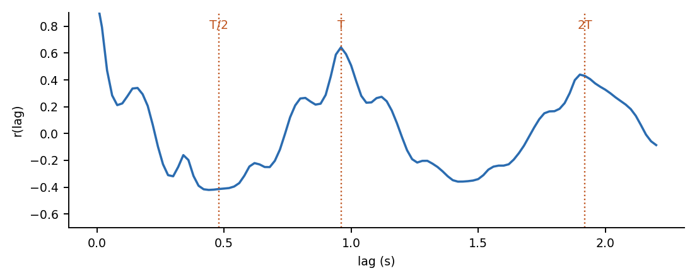

# Module 3: the cycle length from autocorrelation, by hand

**Question:** how long is one heartbeat? We do not know where S1 is yet. But the envelope repeats every heartbeat, so it should look like itself when shifted by one cycle.



## The calculation

For lag `l` (a shift by `l` samples; the envelope here has 50 samples per second):

```
r(l) = sum over t of (e[t] - mean) * (e[t+l] - mean)  /  sum of (e[t] - mean)^2
```

`r(0) = 1`. A high `r(l)` means "shifted by `l` looks like the original". In the figure there are peaks at one cycle `T` (0.96 s) and at `2T`, and a dip at `T/2`: half a cycle lines up S1 with S2, which are different sounds, and systole with diastole.

The candidate cycle lengths are the strongest peaks between 0.35 s and 2.0 s. Here the top three are 0.96 s (r = 0.64), 1.90 s (r = 0.44) and 1.12 s (r = 0.27).

## The problem this creates

The peak at `2T` is almost as strong as the one at `T`, because two beats later also looks like the original. The search must choose between them, and a wrong choice makes every later step wrong. That is module 4.

## Files

| File | What it is |
|---|---|
| [`autocorr_by_hand.xlsx`](autocorr_by_hand.xlsx) | the envelope (400 values), 101 lags as `SUMPRODUCT` formulas, peak finder with `LARGE`, chart; difference to numpy printed |
| [`../hsbh/cycle.py`](../hsbh/cycle.py) | `autocorr`, `local_peaks`, `top_periods` |
| [`../tests/test_cycle.py`](../tests/test_cycle.py) | equals `numpy.correlate` to 1e-12; cycle length found within 6% on synthetic recordings at 55, 70 and 90 bpm |
