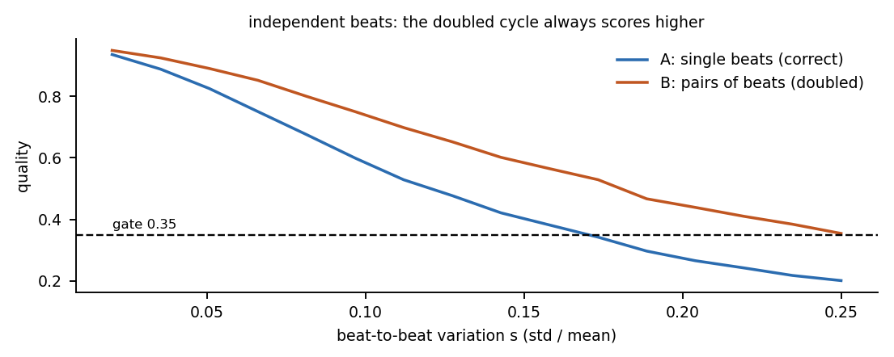
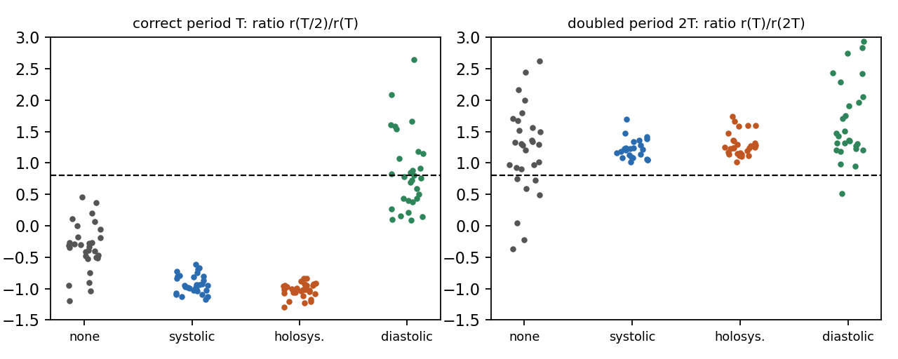

# Module 4: why a quality score can prefer a doubled cycle

**The story.** In a real adult recording (a mitral-regurgitation patient, `MR_011` of the BMD-HS dataset) a segmentation search chose a cycle length of 1.90 s. The right answer is about 0.94 s: it had counted two heartbeats as one cycle. The search scores every attempt by *coverage x regularity x plausibility* and keeps the best. The doubled attempt scored **0.54**; the correct one scored **0.43**. Both passed the quality gate of 0.35, so nothing flagged the error.

This module shows why, with a derivation, a spreadsheet and a simulation, and tests a fix.

## Why the score prefers the doubled cycle

`regularity = 1 / (1 + (CV / 0.12)^2)`, where `CV = std / mean` of the cycle lengths. A doubled cycle is the sum of two neighbouring beats. If the beats vary **independently**, the variation partly averages out: the sum of two beats has a relative spread about `1/sqrt(2)` times that of one beat. A smaller CV gives a higher regularity, so the quality rises. Coverage is the same for both and both pass the gate.



The simulation agrees: with independent beats the pairs score higher at every level of variation (and the test in `tests/test_cycle.py` checks it on 50 recordings).

**Limit of the derivation.** Real hearts do not vary independently from beat to beat, so the effect in a real recording is weaker. In `MR_011` the CVs were 0.131 (19 cycles) and 0.109 (9 cycles), the same direction but a smaller drop than `1/sqrt(2)`. So this explains the *direction*, not the size, and one recording is an example, not a proof.

## A fix to test: the half-cycle test

For a true cycle `P`, half a cycle is a different part of the heartbeat, so `r(P/2)` is low. For a doubled `P = 2T`, `P/2` is one whole beat, so `r(P/2)` is as high as `r(P)`.

```
ratio = r(P/2) / r(P)        if ratio > 0.8, call P doubled and use P/2     (0.8 is a teaching choice, not tuned)
```

## Results on 120 synthetic recordings (`python 04_doubled_cycle/experiment.py`)

| murmur | quality prefers 2T | 2T flagged (hit) | correct T flagged (false alarm) |
|---|---|---|---|
| none | 1.00 | 0.73 | 0.00 |
| systolic | 1.00 | 0.83 | 0.00 |
| holosystolic | 1.00 | 0.97 | 0.00 |
| diastolic | 0.97 | 0.93 | **0.47** |



**The test works except for diastolic murmurs**, where it wrongly rejects a correct period in 47% of recordings. A diastolic murmur fills the gap after S2, which makes the two halves of the cycle look alike. These are the murmurs of aortic regurgitation and mitral stenosis, so the case where the fix fails is the case where it would matter. The simulation is synthetic and uses a threshold chosen by hand; it shows a mechanism and a limit, not performance on patients.

## Files

| File | What it is |
|---|---|
| [`doubled_cycle_by_hand.xlsx`](doubled_cycle_by_hand.xlsx) | sheet 1: 20 beats, pairs, coverage, regularity, quality, which wins; change the variation `s` and watch it. Sheet 2: the half-cycle ratio and the table above |
| [`experiment.py`](experiment.py) | the simulation and the figure |
| [`../hsbh/cycle.py`](../hsbh/cycle.py) | `quality`, `pair_sums`, `half_cycle_ratio` |

Open question for you (exercise 5): why exactly does a diastolic murmur raise `r(T/2)`? Prove or disprove your answer with the simulation.
