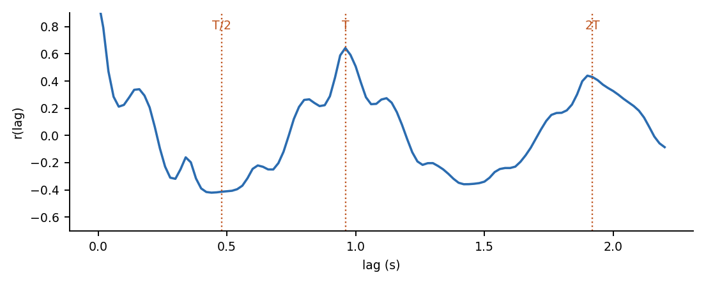

# Heart sound by hand

The steps of a phonocardiogram (heart sound) pipeline, worked out by hand in Excel and in short, readable Python, and checked against the standard libraries.

> **Author:** [YOUR NAME], [UNIVERSITY], supervised by [SUPERVISOR].  **Status:** first release, modules 1 to 4 of 9.

## Why this exists

Most heart-sound code calls `filtfilt`, `hilbert` or a classifier and moves on. This repository opens each call. For every step you get:

1. an **Excel workbook** where every number is a formula you can click and follow with a pencil,
2. a **short NumPy version** of the same steps,
3. a **test** that proves the by-hand version equals the library (largest difference printed),
4. **exercises** and a few **viva questions** to find out whether you really understood it.

It also contains one result that is not in tutorials: **why a quality score can prefer a doubled heartbeat** (module 4), shown with a derivation, an Excel sheet and a simulation, including where the proposed fix fails.

## The map

| # | Module | By hand | Checked against | Status |
|---|---|---|---|---|
| 1 | [Zero-phase filtering](01_filtfilt/) | forward pass, flip, backward pass, flip, edge padding | `scipy.signal.filtfilt` (3e-15) | done |
| 2 | [Envelope](02_envelope/) | Hilbert amplitude as a sum, power mean, Gaussian smoothing | `scipy.signal.hilbert`, `gaussian_filter1d` | done |
| 3 | [Cycle length](03_cycle_length/) | autocorrelation, peaks, candidate periods | `numpy.correlate` (5e-16) | done |
| 4 | [The doubled cycle](04_doubled_cycle/) | quality score, why 2T wins, the half-cycle test | simulation, 120 recordings | done |
| 5 | Segmentation | link S1, S2, S1 with timing windows | | planned |
| 6 | HSMM and Viterbi on a tiny example | fill the Viterbi table | | planned |
| 7 | Features | cycle-warped band templates | | planned |
| 8 | Logistic regression | loss, gradient, penalty, one step | `scikit-learn` | planned |
| 9 | Honest evaluation | patient-grouped splits, leakage on purpose | | planned |



## Run it

```bash
pip install -r requirements.txt
pytest -q                                   # 15 tests: by-hand versus library
python 04_doubled_cycle/experiment.py       # the doubled-cycle simulation (about a minute)
python tools/build_workbooks.py             # rebuilds the Excel files
python tools/make_figures.py                # redraws the figures
```

Open the workbooks in Excel, LibreOffice or Numbers. Cells with blue text on yellow are inputs you can change. Everything else is a formula.

## Data

No real patient data is included. Every example uses a **synthetic heart sound** ([`hsbh/synth.py`](hsbh/synth.py)) whose S1 and S2 times are known, so any step can be scored against the truth. For real recordings see PhysioNet/CinC 2016 (check its licence before redistributing anything). Datasets with patient recordings are never committed here.

## What this does not show

- It does not show that the methods work on real recordings: the experiments are simulations, and the one real recording that motivated module 4 is described with numbers only.
- The by-hand Hilbert transform is a truncated approximation (1 to 5% off in the heart-sound band with 31 taps). Use `scipy.signal.hilbert` in practice.
- The half-cycle test of module 4 fails for diastolic murmurs in the simulation. That is reported, not hidden.

## How this was made

The code, workbooks and text were written with AI assistance (Claude). Every number was checked: the by-hand code against the libraries in `tests/`, and the Excel formulas against the Python values. [YOUR NAME] studied each step and keeps notes in [`LEARNING_LOG.md`](LEARNING_LOG.md); the questions in [`docs/VIVA_QUESTIONS.md`](docs/VIVA_QUESTIONS.md) are the ones to be able to answer without the files.

## Cite and licence

Code: MIT. Text and figures: CC BY 4.0. If this helps you, cite it as in [`CITATION.cff`](CITATION.cff).
